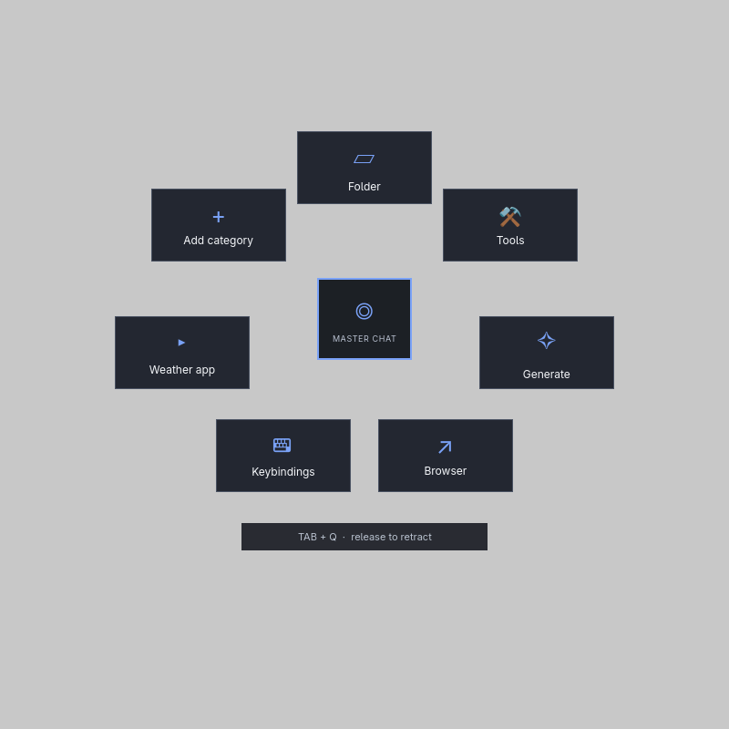
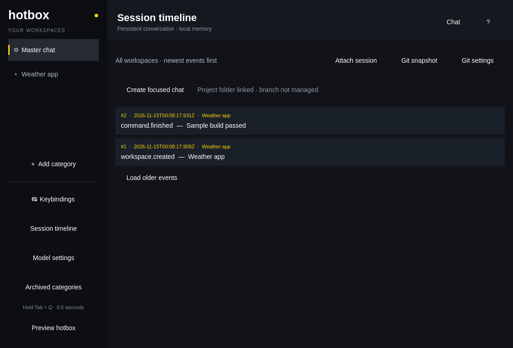
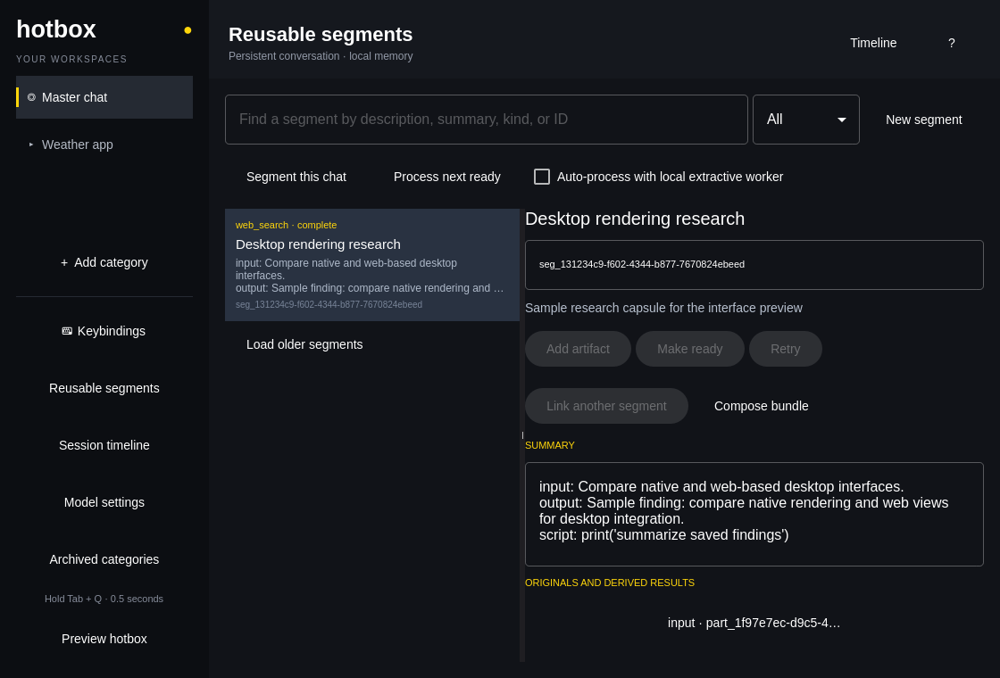
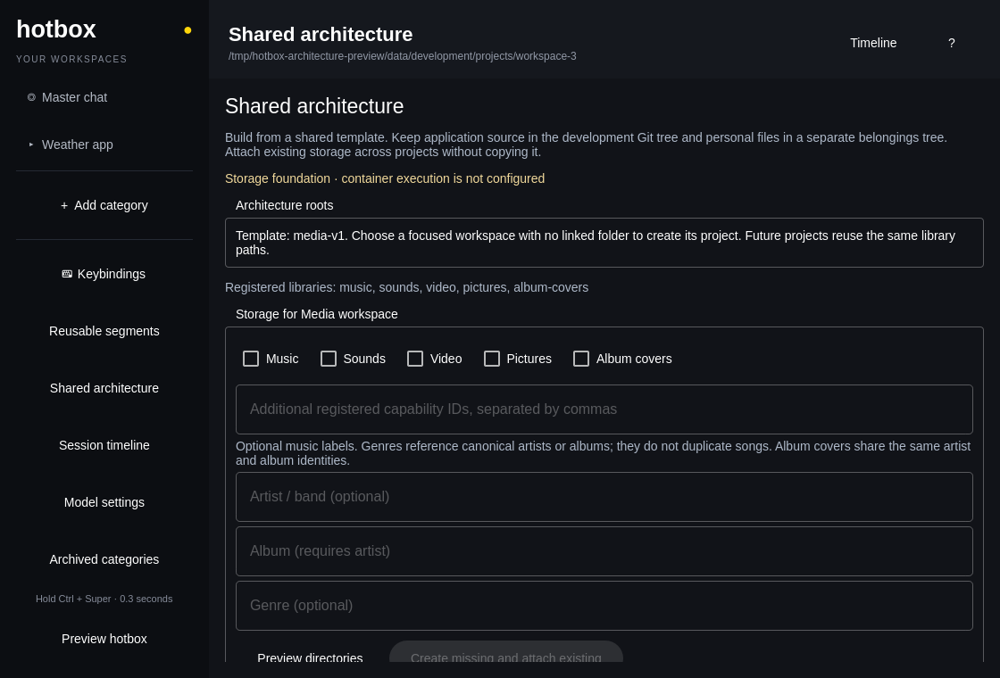

# Hotbox

A native Omarchy hotbox with persistent category chats, project briefs, folder links, and live shortcut search.

A separate [Rust orchestration core](core/README.md) now provides a tested local
foundation for mandatory segmented workflows, SQL checkpoints, bounded execution
loops and delegated-permission rules. Its [implementation plan](core/docs/PLAN.md)
defines the remaining service, isolation and PTC work. This core currently runs
deterministic fixtures; it is not connected to the desktop app or a model provider.

See the [project documentation index](docs/README.md) and the
[Rust core reference](core/docs/README.md) for architecture, executable contracts,
CLI examples, governance rules, recovery procedures and development guidance.

The intended global gesture is to hold **Ctrl + Super** in either order for 0.3 seconds. The menu expands at the pointer; release either key to retract. Click a choice, right-click for deeper actions, or double-click the center for master chat.

The global shortcut observes Ctrl and Super without consuming them. Left and right modifier keys are supported. Physical-keyboard activation remains unverified; use `hotbox open` and its **Preview hotbox** button as an alternative.

## Build and run

`bin/build`, `bin/test`, then `build/hotbox open`. Install system-wide with `bin/install`, or use `bin/install-local` for an atomic user-local update with a database backup and resident-app restart. `hotbox daemon` runs in the background; `hotbox open` opens the chat; `hotbox menu` previews the hotbox; `hotbox release` dismisses it; `hotbox keybindings` opens shortcut search; `hotbox quit` stops the resident app.

`hotbox check --json` reports database and model configuration status without a display. `hotbox --smoke OUTPUT_DIRECTORY` renders sample chat and menu screenshots offscreen, using an isolated database.

The development machine uses a user-local install: executable in `~/.local/bin/hotbox`, desktop entry in `~/.local/share/applications/`, and keyboard integration in `~/.local/share/hotbox/hotbox.lua`. Startup is configured in the user's Hyprland autostart; their bindings load the integration file. System package installation was not completed because sudo authentication was required.

`integration/hotbox.lua` contains the Ctrl + Super bindings. The Arch package installs that file at `/usr/share/hotbox/hotbox.lua`. Configuration changes require `hyprctl reload` and `hyprctl configerrors`. Install or change desktop bindings only when explicitly requested.

## Verification

Twenty-one Qt Test checks cover the application. `bin/test-cli` exercises the complete headless session workflow after a build. The Qt Test suite covers persistence and archive restoration, hold timing, settings validation, streamed replies returning to their original workspace, failed connections retaining messages, scoped event retrieval, redaction, focused handoffs, bounded context, isolated Git worktrees, local bare-remote pushes, background scheduling, context-tool round trips, architecture registration, shared-library reuse, and preservation of user files. Offscreen screenshots use sample content. The live overlay rendered successfully; the previous Tab + Q shortcut failed verification. The replacement Ctrl + Super bindings passed Lua callback checks and loaded in Hyprland without configuration errors; they still require a physical-keyboard check. Keep desktop keyboard injection out of further automated checks.

## Model connection

Open Model settings. Enter an OpenAI-compatible **chat completions** endpoint, model name, and API-key environment variable (default `HOTBOX_API_KEY`). The default endpoint is local Ollama at `http://127.0.0.1:11434/v1/chat/completions`; choose an installed model. Remote endpoints require HTTPS. Secrets are read from the process environment, never saved to SQLite. Restart the daemon after changing its environment. Sending transmits a bounded project brief, recent event summaries, and up to 12 recent messages (12,000 characters total). Master chat also receives a compact directory of up to 40 visible workspaces. Each request is capped at 64,000 serialized bytes, with at most four rounds of two context lookups. Older messages remain in the local database and can be read through their event references.

Without a model, messages still save locally and the app explains how to connect replies. Model responses stream and survive restart. Stop preserves partial responses. The model can look up events and create focused child chats through function tools. It cannot edit files, execute commands, or manage Git itself; Generate opens the category chat for discussing a request. Use a model that supports Chat Completions function tools.

## Memory

SQLite in `~/.local/share/hotbox/hotbox.sqlite3` stores category hierarchy, messages, project folders, user-maintained briefs, and non-secret model settings. The entire chat history is retained. The editable Project brief supplies durable context to each new model request; history is retrieved on demand through scoped context tools, rather than a semantic embedding index. Archives retain chats and folder links. Restore from the sidebar. Creating a category links a folder without creating or modifying it.

## Shortcuts

| Keys | Action |
| --- | --- |
| Hold Ctrl + Super | Hotbox after 300 ms |
| Release either key | Retract without launching |
| Ctrl+K | Search Omarchy bindings |
| Ctrl+N | Add category |
| Ctrl+, | Model settings |
| Enter / Shift+Enter | Send / newline |
| Ctrl+Q | Quit resident app |
| ? outside composer | Help |

`Q` alone is not bound to quit because chats must allow normal typing. Undo and redo use the text controls' standard shortcuts.

## Session timeline and focused chats



Open **Session timeline** from the sidebar or the chat header. Master chat sees events across the workspace tree; a focused workspace sees its descendants. Rows contain a stable sequence ID, UTC timestamp, workspace, event kind, and short description. Click a row to read details in bounded pages. Load older events to continue through history. Existing saved chats are indexed during the database migration.

Chats, brief edits, focused handoffs, session attachments, recorded commands, Git snapshots, checkpoints, and failures enter the same private SQLite ledger. The event session ID groups records from a single app/CLI process. Imported log files are snapshots attached at import time; their original internal timestamps remain in the attachment. Attach text or JSONL files up to 256 KiB. Common credentials are redacted, but pattern matching is not a complete secret detector. Do not attach material you do not want the configured model to access.

**Create focused chat** creates a child conversation with a short goal, bounded parent brief, and links to recent parent events. It shares the model connection and initially links the same folder. It does not copy the entire history or launch another autonomous model process. The master can also invoke `focus_workspace`; the new child appears in the sidebar. `workspace_overview` and `read_event` retrieve detail within the originating conversation's scope, even if you switch windows while a reply arrives.

This is a master index of linked projects, not an automatic conversion of unrelated Git repositories into one physical repository. Each linked repository retains its own history.

## Background Git

From a project's timeline, open **Git settings**, then **Create isolated branch and worktree**. Hotbox creates a `hotbox/<uuid>` branch from the linked repository's committed `HEAD`, in the app data directory's `worktrees/` folder. The focused workspace then points to that worktree. Uncommitted changes in the original folder are not copied or altered. This is a local branch/worktree fork, not a hosting-service repository fork.

Enter exact relative file paths, one per line. Checkpointing commits only those files, including explicitly selected new files or deletions. Directories, symlinks, path traversal, common credential paths, raw `.log`/`.jsonl` files, databases, and detected credentials are rejected. Pre-existing staged changes pause the operation. Repository hooks are disabled for managed operations; ordinary commits made outside Hotbox retain their usual behavior. Operations run off the UI thread and are serialized per worktree.

Enable **Checkpoint selected files every minute** to persist that policy. Enable push only after selecting an existing named remote, such as `origin`. Push targets only that managed branch, uses existing Git authentication without prompting, and never force-pushes. Failures are recorded and pause automatic Git until you explicitly resume it. Hotbox does not merge, rebase, clean, reset, delete branches, or prune worktrees in the background. Checkpoints also record Git status, tracked file tree, recent commit timestamps, and the resulting commit ID. Raw sessions and conversation databases stay local.

The Hotbox development repository uses `https://github.com/Zero2oneZ/agentic-smart-mouse.git` as `origin`, authenticated through GitHub CLI. Background push remains opt-in per managed workspace.

## Session commands

All commands below work without a display and emit JSON. Add `--data-dir PATH` before `--` to use a separate private database. Category IDs are shown in timeline rows and returned by `focus`.

```sh
hotbox events --category 1 --json
hotbox read-event --category 1 --id 42 --offset 0 --json
hotbox focus --category 1 --name "Menu layout" --brief "Fix edge placement" --folder ~/Work/project --json
hotbox attach --category 2 --path ~/session.jsonl --json
hotbox record --category 2 --kind session.note --summary "Decision" --content "Use native Qt" --json
hotbox run --category 2 -- make -j4
hotbox snapshot --category 2 --json
hotbox branch --category 2 --json
hotbox git-config --category 2 --paths src/main.cpp --remote origin --automatic --push --json
hotbox sync --category 2 --json
```

`run` executes only the program and arguments you explicitly supply, in that category's folder. It captures bounded output, working directory, exit status, start/end events, and elapsed time, with a two-minute timeout. It is not a global shell recorder. Existing external sessions can be attached explicitly; Hotbox does not crawl other applications' histories. Background Git runs while the resident app is running. External CLI changes are reflected in the app within about two seconds.

## Reusable session segments



Open **Reusable segments** to organize work into discoverable units. Each `seg_<uuid>` has a kind (`web_search`, `code`, `analysis`, `chat`, or another simple label), title, description, summary, workspace, timestamps, and state. Its ordered `part_<uuid>` artifacts retain input, output, scripts, sources, history, notes, and derived results separately. Text artifacts have SHA-256 fingerprints of the redacted stored text; event-reference artifacts point to the original ledger event. Original source files are never changed.

The lifecycle is `collecting → ready → processing → complete`, with `failed → ready` for explicit retries. Add artifacts while collecting, then **Make ready** to seal the evidence. A worker claims a ready job with an exclusive lease; expired leases can be reclaimed after a crash. Completion requires the current unexpired lease and stores a derived result, description, and summary without replacing the originals. Failed attempts retain diagnostic artifacts. Initial descriptions and completed summaries are recorded as revisions.

**Process next ready** runs `builtin.extractive-v1`, a deterministic local processor. It collects bounded text excerpts and linked summaries into a result manifest. This is extractive indexing, not AI interpretation or a web-search agent. Optional **Auto-process** applies it every five seconds while Hotbox runs; it is off by default so external workers can claim waiting jobs. Stored scripts are inert evidence and are never executed by this processor.

**Segment this chat** references up to the most recent 100 timeline entries, selecting this workspace's chat messages. Long-form messages remain available through the event references. For longer sessions, create multiple continuation segments or attach exported text artifacts explicitly. Each text artifact is limited to 1 MiB and is rejected, rather than silently truncated, when larger. Artifact reads are paged in 6,000-character chunks.

Use `uses`, `derived_from`, and `continues` links to assemble context. **Compose bundle** creates a segment holding component references, rather than duplicating source transcripts. Ready and process the bundle to capture a summary of those components. Summaries describe the evidence available when processing occurred. Later work belongs in a new linked continuation. Segment descriptions and summaries are searchable; full-text artifacts are fetched only when needed.

Master chat can discover segments across all workspaces. Focused chats inherit references to at most five recent segments and can read those specifically granted segments, including their evidence; they cannot mutate inherited parent segments. Model tools `find_segments`, `read_segment`, and `read_segment_part` retrieve summary metadata or selected originals within scope. Model tools do not claim jobs or execute stored scripts. A model connection is still required for AI interpretation.

### Worker protocol

All commands emit JSON and use the same local SQLite database as the app. External workers can be ordinary programs using this protocol; Hotbox does not require a continuously running AI process.

```sh
hotbox segment create --category 2 --kind web_search --title "Rendering options" --description "Compare native rendering approaches"
hotbox segment add --category 2 --id SEGMENT_ID --kind input --content "Research question"
hotbox segment add --category 2 --id SEGMENT_ID --kind history --content-file ./search-history.jsonl
hotbox segment add --category 2 --id SEGMENT_ID --kind script --content-file ./analyze.py
hotbox segment add --category 2 --id SEGMENT_ID --kind source --source https://example.org/reference --content "Relevant source excerpt"
hotbox segment add --category 2 --id SEGMENT_ID --kind output --content-file ./findings.json
hotbox segment ready --category 2 --id SEGMENT_ID
hotbox segment claim --category 2 --worker research-processor --seconds 300
hotbox segment read --category 2 --id SEGMENT_ID
hotbox segment part --category 2 --id PART_ID --offset 0
hotbox segment renew --category 2 --id SEGMENT_ID --lease LEASE_TOKEN --seconds 300
hotbox segment finish --category 2 --id SEGMENT_ID --lease LEASE_TOKEN --description "Rendering comparison" --summary "Prefer native Qt for this app" --content-file ./derived-result.json
hotbox segment list --category 1 --state complete --query rendering
hotbox segment compose --category 2 --title "Implementation context" --ids FIRST_SEGMENT_ID,SECOND_SEGMENT_ID
```

Use IDs returned by `create`, `add`, and `claim`. The claim response includes the lease token and expiry; normal readers do not receive the token. Leases last 1–3,600 seconds (default 300). Claiming with master category 1 considers all non-archived workspaces; a focused category only claims its own descendants, not inherited segments. `segment fail --id ID --lease TOKEN --error TEXT` records a failure, and `segment retry --id ID` requeues it. Keep the same `--category` throughout a worker's operations.

To reuse command I/O already captured by `hotbox run`, attach the returned event with `segment add --category ID --id SEGMENT_ID --kind history --event EVENT_ID`. `segment from_chat --category ID --title "Chat checkpoint"` captures chat references; `segment process --category ID` processes the next ready segment locally. List results are newest first and accept `--before SEQUENCE` for pagination.

Everything remains local unless you explicitly export it. No external database connector or live web-search worker is configured by this feature. Common credential patterns are redacted before storing new artifacts; this is not a complete secret detector. Session artifacts and summaries remain outside pushed Git branches.


## Shared development architecture and user belongings



Open **Shared architecture** in the sidebar. From **Master chat**, initialize two empty roots (defaults shown below). Hotbox initializes a local Git monorepo for templates and project source, with an initial architecture commit. If master chat has no linked folder, it links this root. Existing linked repositories are left alone. No remote or automatic push is configured for this new monorepo. The development machine runs Hotbox 0.4.0 with both default roots initialized.

```text
~/.local/share/hotbox/development/       Tool-managed Git tree
  architecture.json
  templates/media-v1.json
  projects/workspace-<id>/
    project.json
    src/

~/.local/share/hotbox/belongings/        User/runtime tree, outside Git
  apps/workspace-<id>/
    state/
    config/
    cache/
  media/                               Only requested libraries are created
    music/artists/<artist>/albums/<album>/songs/
    music/genres/<genre>/
    pictures/bands/<artist>/album-covers/<album>/
    sounds/
    video/
  libraries/                           Additional registered capabilities
```

These are corresponding trees, not synchronized copies. The template describes the shared layout. Each focused project gets its own source scaffold and runtime state, with private registry bindings to shared user libraries. A project must have no linked folder, or already link its managed scaffold; Hotbox does not adopt or reorganize unrelated folders.

In a focused workspace, choose **Music**, **Sounds**, **Video**, **Pictures**, or **Album covers**, optionally supplying artist, album and genre labels. **Preview directories** shows which paths already exist. **Create missing and attach existing** recomputes the plan, creates missing directories, and reuses existing ones without replacing files. Repeating the same request or requesting it from another project reuses the same library. Adding a genre records an association with the canonical artist or album instead of copying its music. Artist and album directory names use normalized labels plus a stable hash to avoid collisions. Songs are files an app can later place in the songs directory; this feature does not import or classify media.

Master chat can **register additional capabilities** with a stable ID, description, and relative `media/` or `libraries/` path. Registering changes the versioned architecture definition; the directory is created only when a project requests that capability. Existing IDs and paths cannot be repointed implicitly. The starter schema supports up to 32 capabilities. Changes to the core layout require an explicit schema migration; editing it incompatibly pauses provisioning.

Runtime bindings, genre associations, personal labels and provisioning events stay in the private SQLite registry. The source scaffold contains no absolute runtime paths or artist/album labels. Source scaffolds and capability-definition changes are left for normal explicit Git checkpoints. Archives and source rebuilds do not delete belongings. Back up the belongings tree and private registry separately; the source Git repository does not back them up.

Model tools `read_architecture` and `plan_storage` inspect scoped bindings and propose plans without changing files. The UI and CLI perform provisioning. Master can inspect all workspace bindings; focused chats see their descendants' bindings. Reusing storage is an explicit attachment by the user. These are logical ownership and context boundaries within one local OS account, **not container filesystem isolation**. Container execution, image builds, filesystem mounts, automatic migrations, importing existing libraries, and semantic classification are not implemented by this storage feature.

```sh
hotbox architecture init --category 1
hotbox architecture catalog --category 1
hotbox architecture define --category 1 --id documents --relative-path libraries/documents --description "Shared documents"
hotbox architecture plan --category PROJECT_ID --capabilities music,album-covers --artist "Example Band" --album "Example Album" --genre "Rock"
hotbox architecture ensure --category PROJECT_ID --capabilities music,album-covers --artist "Example Band" --album "Example Album" --genre "Rock"
```

`init` accepts `--tool-root` and `--runtime-root` for separate absolute locations outside existing Git repositories. Roots must initially be empty; symlinks, overlapping roots and roots containing the private database are rejected. Roots cannot be changed after initialization through this API. Paths from templates are validated before use. A local lock serializes registry mutations. On an I/O failure, already created directories remain in place; provisioning can be retried after the underlying problem is resolved. Hotbox never deletes directories to roll back an error.


## Standalone tool lineage registry

The separate Rust core now records immutable tool identities and versions, full Git
commit references, architecture versions, originating chat references and fork
ancestry. `tool_context` resolves a selected version under a live `source.read`
grant. Forks require a distinct destination resource owned by the caller and a new
chat reference; they copy version metadata only, leaving grants, credentials,
runtime bindings and the original tool unchanged. This is a local registry, not a
Git copy operation or a connected Edit/Fork UI. Reviewed plans and contribution
agreements remain future work. See [core CLI](core/docs/CLI.md#tool-lineage-registry).

The core check suite covers 24 integration tests plus the multi-process CLI fixture.
It runs independently of the installed Qt application. Kernel schema 1 upgrades
transactionally to schema 2; back up the separate kernel database before opening it
with this version. The Qt chat database is never migrated by the core.
