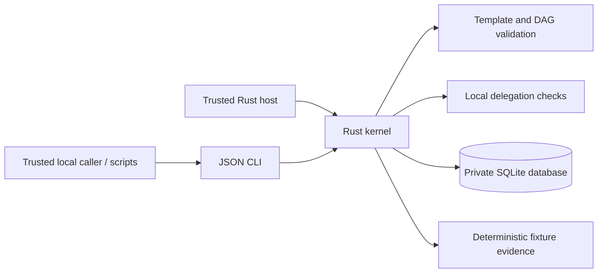
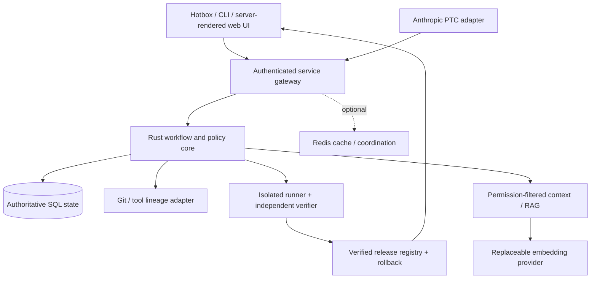

# Architecture and system boundaries

## Purpose

Build a portable orchestration foundation whose deterministic operations work
before agents are introduced. A future desktop or web host should be able to
embed or fork it without requiring Omarchy. SQL owns durable state; model providers,
frontends, execution environments and retrieval services attach through explicit
interfaces. No product branding has been selected.

## Implemented components



| Module | Responsibility | Does not do |
| --- | --- | --- |
| `model.rs` | Typed contracts, template validation, hashing, fixture evidence and public views | Read project files or execute build commands |
| `permissions.rs` | Resource ownership, grant issuance, lineage checks and revocation | Authenticate people, devices or network callers |
| `engine.rs` | SQL persistence, scheduling, leases, budgets, completion and events | Run containers, create Git branches or activate software |
| `main.rs` | One-request JSON transport and a bounded fixture loop | Start an HTTP/GraphQL server or daemon |
| `templates/` | Versioned executable fixture specifications | Trusted production build instructions |
| `scripts/` | Verification and a temporary multi-process demonstration | Install or configure the desktop |

The CLI and library share the same kernel operations. No network or shell executor
exists in the crate. Fixture output consists of digest strings recomputed from the
pinned context. A fixture named `activate` tests a protocol stage; it changes no
release pointer and launches no application.

## Relationship to the existing application

The Qt app already has local chats, scoped event references, reusable segments,
managed Git worktrees and a storage architecture registry. These remain implemented
in C++/QML. The Rust core does not replace them or synchronize with them yet.

| Existing app | Rust kernel |
| --- | --- |
| `hotbox.sqlite3` with chats, categories and storage bindings | Explicitly selected, separate orchestration database |
| Qt/QML interface and Hyprland integration | Library and JSON CLI |
| Category hierarchy and explicit history grants | One named resource and grant per run |
| Existing Git/worktree operations | No Git mutation |
| Lazy user-library provisioning | No directory provisioning |

The app's reusable session segments and the kernel's workflow segments are different
entities. A session segment stores reusable evidence. A workflow segment represents
one declared execution step. A future integration may reference the former from
the latter, without conflating their IDs, leases or state machines.

## Three different graphs

1. **Execution DAG:** determines which workflow segments depend on which others.
   Implemented, with mandatory stage barriers and serial scheduling per run.
2. **Permission lineage:** determines which grants derive authority from which
   parent. Implemented locally; bounded to 32 grants per chain.
3. **Tool/version lineage:** determines which tool version was edited or forked
   from another. Target only; Git refs alone do not implement this registry.

GraphQL, when added, will expose queries over state. It will not itself execute
the DAG or establish permission lineage.

## Source and belongings architecture

The existing app provisions two separate roots:

```text
tool-owned development root/       user/runtime-owned belongings root/
  architecture.json                 apps/<project>/state/
  templates/                        apps/<project>/config/
  projects/<project>/src/            apps/<project>/cache/
                                    media/ and libraries/
```

The relationship is a capability binding, not a recursive copy or directory mirror.
Source templates describe capabilities; local runtime bindings resolve those
capabilities to user-owned locations. Multiple apps can explicitly reuse the same
library. A rebuild or fork must not implicitly move, duplicate or delete belongings.

Personal metadata, content, runtime paths and credentials do not belong in a
distributable mother repository. The existing storage registry is a logical local
boundary, not OS-level isolation. The Rust kernel currently names resources for
policy evaluation; those names do not resolve to filesystem mounts.

## Hotbox context routing — target

| Interaction | Intended result |
| --- | --- |
| Click a category | Enter its next menu layer |
| Click a tool | Launch its declared runtime action |
| Right-click → Edit | Open focused development context anchored to its originating tool/version |
| Right-click → Fork | Create a new tool identity and chat anchored to the selected version |

Each development context should carry the request, pinned version and architecture,
selected skills, concise decisions and evidence references. Retrieve deeper history
only when needed. Forks retain provenance without copying every conversation into
each request. Neither navigation nor a fork automatically grants access to data.
These specific tool-lineage interactions are requirements, not implemented Rust APIs.

## Target service composition



This diagram is a target. The gateway, provider adapter, isolated runner, release
controller, retrieval index, Redis and GraphQL service are not present. The proposed
web UI keeps authoritative state on the server and renders views from that state;
SQL does not render HTML itself. The Rust core must remain independent of those
frontends and providers.

See [the implementation plan](PLAN.md) for dependencies and acceptance criteria.
