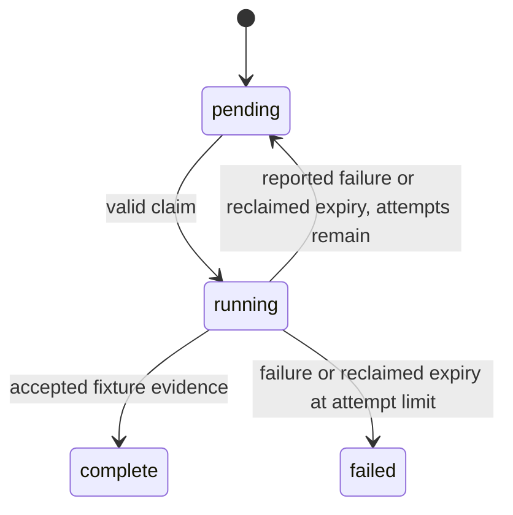

# Executable contracts and state machines

This reference describes schema version 1 as implemented in [model.rs](../src/model.rs)
and [engine.rs](../src/engine.rs). JSON structs reject unknown fields. Templates do
not support arbitrary scripts, executable paths, signed approvals or plugin executors.

## Template fields

| Field | Type | Constraint |
| --- | --- | --- |
| `schema_version` | Unsigned integer | Exactly `1` |
| `id` | String | Kernel identifier |
| `version` | String | Three dot-separated components parsed as unsigned 32-bit integers; multi-character components starting with `0` are rejected |
| `limits` | Object | Run limits below |
| `segments` | Array | 8–64 segments; distinct IDs |

The accepted version format is intentionally narrower than full semantic versioning:
no prerelease or build suffix is supported. Template validation is implemented in
Rust, not through a separately maintained JSON Schema document.

A kernel identifier contains 1–96 ASCII letters, digits, dots, underscores or hyphens,
and cannot equal `.` or `..`. Identifiers label objects; they are not filesystem paths.

| Run limit | Accepted range | Meaning |
| --- | --- | --- |
| `max_operations` | 1–512 | Maximum successful segment claims across the whole run |
| `max_cost_units` | 1–1,000,000,000 | Maximum accumulated abstract cost reservation |
| `deadline_seconds` | 1–86,400 | Seconds from run creation to its absolute deadline |

Validation does not promise the budget is sufficient to complete the graph. A valid
template can deliberately exhaust its budget partway through execution.

## Segment fields

| Field | Type | Constraint |
| --- | --- | --- |
| `id` | String | Unique kernel identifier |
| `stage` | Enum | One of the eight stages below |
| `depends_on` | Array of strings | Existing segment IDs; interpreted as a set |
| `executor` | Enum | `fixture_ok` or `fixture_fail` only |
| `required_actions` | Array of strings | Known action set, maximum eight, including the stage's required action |
| `required_outputs` | Array of strings | 1–8 kernel identifiers; interpreted as a set |
| `max_attempts` | Unsigned integer | 1–5, including expired claims |
| `timeout_seconds` | Unsigned integer | 1–300 |
| `cost_units` | Unsigned integer | Zero through the run's maximum cost units |

| Stage order | Stage | Required action |
| --- | --- | --- |
| 1 | `discover` | `source.read` |
| 2 | `document` | `architecture.read` |
| 3 | `plan` | `storage.plan` |
| 4 | `prepare` | `source.write` |
| 5 | `build` | `build.run` |
| 6 | `verify` | `verify.run` |
| 7 | `release` | `release.publish` |
| 8 | `activate` | `runtime.activate` |

All eight stages must occur. Dependencies cannot point to a later stage, and the
whole graph must be acyclic. Each segment after `discover` must transitively depend
on **every** segment in the preceding stage. Multiple build segments therefore all
precede verification. Additional dependencies within a stage are permitted.

The stage names reserve future responsibilities. Current fixture evidence does
not attest real source inspection, builds, tests or release operations.

## Pinning and context

`start` records the template, its digest, inputs, actor, resource, grant and absolute
deadline. Inputs are a string map with at most 32 keys. Keys are identifiers, each
value is at most 4,096 UTF-8 bytes, and serialized inputs are at most 32,768 bytes.

The template digest is SHA-256 over its compact Rust/Serde JSON serialization after
validation. Set/map order is deterministic through ordered collections. The segment
array retains its original order. Whitespace in the input file is not hashed.
This is an implementation-defined serialization, not a general canonical-JSON or
cross-language signing format. Persist and reuse the returned digest; future
signature/interoperability work must specify a canonical format explicitly.

A claim contains the run's bounded input map and direct dependencies' output maps.
It does not automatically include all historical conversations or read input values
as paths. Version 1 sends that same input map to every segment; per-segment selection
and permission-filtered retrieval are future work.

## Scheduling and attempts

One segment at a time may be running within a run. Among ready pending segments,
selection is by stage order, then segment ID. Dependencies must be complete.
Separate runs can progress independently, subject to SQLite writer serialization.

A successful claim increments the run's operation count and the segment's attempt
count, and reserves its declared cost. Reservations are not refunded for worker
failure or expiry. Claim calls that return `idle` do not consume another operation.

Each claim binds a worker name and attempt-specific token. Its expiry is:

```text
min(run deadline, claim time + segment timeout)
```

Completion checks the current run state, deadline, worker, token, expiry and live
permission chain. The kernel reconstructs the expected claim context from SQL;
the worker cannot replace the stored contract by sending a modified claim.

Expired work is reclaimed only when a subsequent authorized `claim` evaluates it.
The next claim gets a new token. At the attempt limit, lease expiry fails the segment
and run instead of reclaiming it again. There is no heartbeat/lease-renewal command.

## States



| Run state | How it is persisted |
| --- | --- |
| `running` | Accepted start request |
| `complete` | Last segment successfully finishes |
| `failed` | A segment permanently fails through report or reclaimed expiry |
| `budget_exhausted` | Next ready claim would exceed operation or cost limits |
| `expired` | An authorized claim observes the absolute deadline |
| `cancelled` | Owner cancels a still-running run |

Run terminal states cannot be resumed or edited. Use a new run ID. Expiry and
cancellation clear leases but may leave a segment's last status as `running` in
its public view; the run's terminal state governs whether execution is possible.

`status` returns persisted state and does not advance timers. A `finish` past the
deadline fails without itself persisting `expired`; the next authorized claim does
that. A grant expiry or revocation instead causes denial, leaving the run checkpoint
unchanged until an owner cancellation or future administrative mechanism.

## Fixture verification

`fixture_ok` returns one digest string per declared output. Each digest is computed
from the template hash, segment ID, bounded inputs, direct dependency outputs and
output name. The kernel independently recomputes and compares the complete map.
Missing, extra or changed outputs are rejected without completing the segment.

`fixture_fail` produces a failure report. It cannot be reported successfully.
Workers may report failure for either executor; accepted failure consumes the
attempt and either retries or fails permanently. The report's error string is at
most 1,024 bytes and is not saved in audit detail. These are protocol fixtures,
not independent production verifiers.

## Retry and replay semantics

| Operation | Repeated request behavior |
| --- | --- |
| `resource` | Same owner and ID succeeds without another creation event; another owner conflicts |
| `grant` | Duplicate ID conflicts; grants are immutable except revocation |
| `revoke` | An authorized repeated revocation succeeds without another event |
| `start` | Same ID and pinned request returns existing state; different request conflicts; live access is still required |
| `claim` | No duplicate claim while a live lease exists; a lost claim response leaves work leased until expiry |
| `finish` | A repeated accepted finish is rejected because its lease is cleared or the run is terminal |
| `cancel` | An owner receives current state; terminal runs remain unchanged |

After a lost finish acknowledgement, inspect status/events rather than assuming
the segment failed. The future external runner also needs idempotent side effects;
database checkpointing does not undo or deduplicate an external operation by itself.

## Clock and event model

Production calls use system Unix seconds. Tests inject a manual clock. The clock is
sampled per operation; it is not a monotonic, distributed or rollback-resistant clock.
Changes in wall time can change effective lease and grant duration. Cross-device
execution requires an explicit trusted time/expiry policy before deployment.

Accepted mutations and their events commit in the same SQLite transaction. Events
have a monotonically increasing local row ID, Unix timestamp, actor, kind, optional
run ID and JSON detail. This is a local audit ledger, not a signed or tamper-evident
log. See [CLI event details](CLI.md) and [the security boundary](SECURITY.md).
