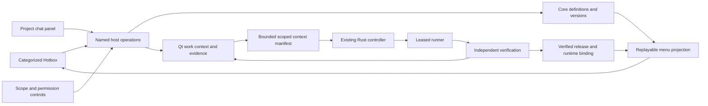

# Categorized tools and persistent work context delivery plan

Deliver one connected path from a Hotbox creation request to a reusable tool entry,
its focused development context and a verified usable release. Side work must
retain a return path to the original objective. Execution remains headless; chat
is a compact view of scoped requests, replies, documents and evidence.

This plan implements the requirements traced in
[the chat and implementation audit](../../docs/CONTEXT_REQUIREMENTS.md). It refines
the [existing architecture](ARCHITECTURE.md), [agent builder](AGENT_BUILDER_PLAN.md)
and [B0–B7 execution roadmap](BUILD_ROADMAP.md); it does not replace their authority
or claim that missing services are available. The first registration slice is now implemented through the
[tool menu API](TOOL_MENU_REFERENCE.md). Other operation/field names below remain
proposed contracts until linked to an implemented interface.

## Acceptance story

Use a synthetic local tool called **Brief formatter**. Its output is a small checked
document produced from fixture text; it touches no personal files or external service.

1. Open Hotbox → Tools → a category → +. Create a tool draft with purpose, project
   context and output destination. Opening or saving the draft starts no worker.
2. The tool appears in that category with honest state and eligible options.
   Edit returns to the bound development context; unavailable Run shows why.
3. Post the formatter task. Open a focused child task to adjust its GUI label.
   The child carries selected references and a parent link, not the full transcript.
4. Finish the child and return a result with changed artifacts, checks, decisions
   and unresolved work. Resume the formatter objective without re-entering it.
5. Restart. Tool identity, category, context, task links and accepted result references
   survive. Old replies keep their original author/model identity.
6. Once B1–B4 are satisfied, execute a declared build/check in an authorized managed
   worktree. An independent verifier checks the exact artifact revision.
7. Activate the verified release. The same tool entry gains its declared runtime
   action; clicking it uses the bound personal runtime. Edit still opens the
   development context. Upgrade and rollback preserve user-owned data.

Steps 1–5 are the first authoring/context milestone. They do not wait for general
swarm execution. Steps 6–7 prove the requested build-to-use loop; a UI prototype
or a metadata registration cannot satisfy them.

## Responsibility boundaries

Qt retains existing chats, categories, private evidence and presentation records.
Rust retains authoritative tool definitions/version lineage and workflow acceptance.
Extend those stores with additive schemas and explicit mappings. A work-context
record is not a second workflow state machine. A menu projection is a read model,
never an authority to run an action. The host resolves trusted local actor context;
models and menu payloads cannot supply their own authority.

## Proposed contracts

| Contract | Minimum contents and owner |
| --- | --- |
| Definition and version | Existing tool identity/resource/version/source/architecture/chat lineage, extended with display metadata, immutable declared action specs and requirement refs; core owned. Reusable agent drafts follow the agent-builder contract rather than treating a run as a definition. |
| Category and placement | Stable category key, parent/reference view, entity-kind/ID, display order and revision. Scope-filtered core metadata with a replayable Qt projection. Category changes never move source, alter grants or rename IDs. |
| Context binding | Installation/legacy namespace + Qt category/chat reference mapped to definition/version and private work-context ID. Verified by the host through named APIs, not trusted because a string is well formed. |
| Work context and task | Durable objective, parent-context/task refs, active task, scope refs, pinned source/contract refs, continuation status and optimistic revision. Qt owns conversation continuity; core attempt IDs are references. |
| Authored message | Message/task/reply-parent IDs, author kind and stable participant ID, display snapshot, requested model/provider and actual receipt refs when known. Historical author/model identity never comes from current settings. |
| Context manifest | Version/digest, task and objective revision, selected summaries and immutable evidence refs, coverage/staleness, source access refs and size budget. Revalidate access at use/export; the manifest itself grants nothing. |
| Focus and return | Parent task, child context, bounded handoff, selected evidence grants, result/decision/issue refs and acceptance status. Return does not overwrite the parent's objective or accept a worker's narrative as verification. |
| Action eligibility | Declared action kind/input schema, selected version/release, required adapter/capabilities, current scope checks, availability and reason. Host allowlisted adapters; no arbitrary shell command from QML or a model. |
| Publication projection | Request ID, authoritative revision/event cursor, definition/release reference, menu/context mapping and receipt. Replays repair links without creating duplicate entities or relaunching work. |

Keep legacy numeric category IDs, segment/artifact IDs and existing run IDs.
Do not equate category, tool, task, agent, attempt or grant IDs. Use the system
model's mapping conventions; review the exact schema/operation catalog before
implementation. Model-inferred category or specialist placement is a proposal.

## Delivery sequence

### P0 Baseline and contract checkpoint

Requirements: H15, H17–H18, R11. Existing execution stage: B0.

Preserve the current working tree and record exact source/helper identities. Add
the work below as versioned contracts/steps in the existing build-ledger workflow
when implementation begins; do not silently write planning prose into production
state. Use the current document/evidence API rather than a parallel task tracker.

Inspect compiler/helper compatibility, schema versions and supported host operations.
Restore fresh Rust compilation and tests on a capable host before changing core
schemas. A desktop-only build with an old helper cannot validate a new core API.
Retain existing known limits: TCP mock checks need a capable host; provider evidence
is separate from mock tests. Missing uv is a B2 preparation issue, not a reason
to install dependencies globally or weaken isolation.

Exit: reviewed requirements and operation ownership, temporary migration fixtures,
reproducible baseline commands/results, and each capability labeled available,
partial or unavailable. This audit supplies the source analysis, not the full B0 gate.

Implementation checkpoint: a cached Rust 1.100.0-beta.7 distribution is installed
under `.tools/rust`. `bin/core-cargo` now routes the full build/check scripts to
that compiler and the private `.tools/cargo` cache. Locked dependencies are fetched;
formatting, Clippy, 51 Rust integration tests and both CLI fixtures pass. A fresh
full Rust/Qt build succeeds. The offline Qt profile passes 44 checks; three TCP
mock checks and authenticated provider behavior remain separate gates. The first
registration slice below is implemented, not the complete P1–P5 path.

### P1 Durable identities and continuity contracts

Requirements: H01, H03, H07, H17–H18, R03, R05–R06, R09–R10.

Extend the existing core tool registry with bounded scoped list/read, editable
display/category placement and versioned action declarations. Implement the
minimal private context/task/message association records in Qt, plus an explicit
Qt/core mapping and a versioned request/receipt/outbox contract. Keep existing
events immutable; attach legacy evidence through references. Do not guess missing
historical task parents from message adjacency during migration.

Expected code: `core/src/lineage.rs`, `core/src/engine.rs`, `core/src/main.rs`,
core schema tests; a focused Qt context-store adapter integrated with `Backend`,
existing chat/evidence stores and the build ledger. Final module names follow
the reviewed contract. Add a canonical operation catalog and reference drift check
using the established build-API pattern.

Exit: migration/restart preserves legacy data; duplicate registration/projection
requests do not duplicate entities; stale edits conflict; invalid scope/mappings
are rejected; concurrent tasks retain independent IDs and pinned objectives.

### P2 Categorized menu entries and contextual authoring

Requirements: H01–H02, H08, H12–H13, R04, R10. Depends on P1.

Replace more negative `currentParent` sentinels with typed routes and a compatibility
adapter for existing category/Tools navigation. Read Tools/Agents entries from the
scoped registry projection. Seed system roots by stable keys, preserve hidden
preferences and avoid collisions with user folders named Tools or Agents.

Contextual + creates/resumes a suitable draft using the current project/category
as a suggestion. A created draft appears immediately in its category; an uncategorized
draft can use an Unsorted view. Saving never runs it. A completed reusable build
must have an idempotent registration/placement result; do not require the user to
recreate a tool as an unrelated generic category.

For tools, show eligible Open/Run, Edit, Versions, Fork, Context and Archive options.
Use tool-specific actions from the validated selected version; show real unavailability
reasons. Agent options follow the existing builder plan, including Test, Pause and
Reports only when the handler/lifecycle exists. Recent/Favorites/Pinned reference
the same typed IDs. Recategorizing does not break pins or development context.

Expected code: `src/Hotbox.qml`, `src/wheel.cpp`, `src/backend.h/.cpp`, bounded
core bridge, resources/translations and offscreen wheel tests.

Exit: create → categorized entry → options → Edit opens the bound context after
restart. Rename/reorder/recategorize preserve identity. Missing/incompatible core
shows an honest availability error. Navigation, + and menu projection replay never
launch a process. Existing mouse/numpad interactions remain covered offscreen.

### P3 Focused side work and durable task discussions

Requirements: H03–H04, H13–H14, R03, R05–R06, R08–R09. Depends on P1; integrates P2.

Extend `focusWorkspace` rather than duplicate it. Record a parent task/context edge,
selected evidence references and a bounded handoff. Add explicit Return to parent
and Resume task operations. The return records a result and unresolved work without
silently merging raw transcripts, granting more access or marking execution verified.
The parent objective remains pinned while the child handles GUI changes.

Group posts/replies by stored task/parent/run associations, including interleaved
workers and paginated history. Keep unknown legacy associations labeled as legacy
activity. Distinguish persisted work steps, saved evidence and attempts. User
corrections to grouping add association history; they do not rewrite source events.

Persist project-scoped drafts and selected task. Separate the project's stable
color/heading from the launch route's stored mark; preserve historical provenance.
Snapshot author/model/provider at message creation and attach actual receipt identity
when available. Show achieved output only with its evidence/status; retain partial,
failed and unverified results. Keep operational details collapsible.

Extend context assembly to read the active objective and task refs first, then
relevant summaries and selected originals, with a versioned bounded manifest.
Never silently truncate an objective/acceptance contract into a different instruction;
return an explicit context-preparation error or request a focused continuation.
Recheck current source access for summaries, originals, caches and provider export.
The current Qt evidence links have no revocation/expiry metadata; define the
policy mapping and enforcement before exposing such guarantees in master controls.
Record partial coverage for legacy clipped event payloads. New oversized evidence
must be chunked into referenced artifacts or rejected explicitly, not silently
converted into an apparently complete summary.

Exit: branch a GUI-label task while building the formatter, switch projects, load
older feed pages and restart; resume the original build with the correct objective,
draft and cited result. Interleaved replies stay attached; old authors never change
when settings change. Cross-scope reads/exports fail without exposing private counts
or summaries. Context preparation remains within an asserted budget.

### P4 Headless controlled execution and master controls

Requirements: H09–H12, H16–H18, R01–R02, R07. Depends on the applicable B1–B4 gates.

Use the existing provider receipts and B2 environment preparation, then connect
general worker dispatch through B3's Rust plans, leases/fences, checkpoints,
idempotent requests and replayable receipts. B4 supplies a real managed-worktree
coding attempt and independent artifact checks. Bind task/context/version/action,
policy, environment and parent budget before dispatch. Preserve unknown usage and
unsupported capabilities; a model cannot grant itself access or accept its output.

The master surface shows declared read/write/output/network scope, context-sharing
bindings, pending decisions, real running/waiting states and stop controls. Existing
authorization applies; add a prompt only when a concrete policy requires one.
GUI/OS changes use explicitly supported host adapters under those same boundaries.
No menu visibility or chat title supplies host execution permission.

Hiding a chat keeps work running. Full app shutdown follows existing interruption
semantics until durable service ownership exists; do not promise restart replay.
Resolve uncertain external effects before retry. A missing kernel runner must not
fall back to an ungoverned QProcess merely to make Run clickable.

Exit: a real bounded task survives UI hiding, records normalized receipts and is
verified against the exact artifact. Duplicate wakes do not relaunch it. Cancellation,
restart, stale lease, scope change and revoked result acceptance behave as specified.
Master controls display effective local capabilities rather than imply remote
multi-user authentication that does not exist.

### P5 Verified release publication and build to use

Requirements: H05–H06, H15, R07, R10. Depends on P2–P4 and verified B4 output.

Connect accepted output to an immutable release record and explicit personal
instance/bindings. Publication adds or updates the same categorized tool entry;
runtime eligibility follows the verified release and actual adapter availability.
Carry source/architecture/context/evidence refs through the publication receipt.

Use atomic activation and tested rollback compatible with belongings/schema versions.
On partial failure keep the last usable release and a recoverable pending projection.
Idempotent replay repairs a lost menu update; it never repeats a build or launch.
An upgrade changes the selected release, not the tool ID, its development history
or another tool's data bindings. Archive semantics fence new work as defined; hiding
a menu entry is a separate preference.

Exit: build → independently verify → activate → launch from the categorized entry;
Edit still reaches the original context. Upgrade, cancellation, failed activation,
rollback and missed UI notification preserve data and recover consistently.

### P6 Reusable agents and measured expansion

Requirements: H08–H11, H16. Reuse the authoring/menu/context infrastructure above.

Implement agent drafts/requirement checks and typed builder routes from
`AGENT_BUILDER_PLAN.md`; do not rename the existing run monitor into a builder.
Manual disabled drafts can arrive before P4. Real agents use P4/P5's proven
control/publication path, pinned skill/task/harness definitions and scoped personal
outcomes. Do not require a VM, RAG, scheduler or specialist team for a simple tool.

B5/B6 then adds bounded planning and a builder/verifier team when needed; B7 measures
candidate optimization against verified outcomes. Count planning, retrieval, failed
attempts and optimization cost. Schedules, remote sharing, browser replay, extra
runner backends and large swarms remain later adapters, not alternate controllers.

## Verification matrix

| Proof | Existing regression base | New acceptance coverage |
| --- | --- | --- |
| Definition/version lineage | `tool_versions_are_immutable_and_context_survives_restart`, fork/grant tests in `core/tests/kernel.rs` | Scoped listing, category/action revisions, migration, request dedup, verified chat mapping |
| Menu/context identity | `wheelPreferencesAndStarterEvidencePersist`, `mouseWheelDirectionsSpreadsAndNotes`, `feedOriginsStayAttachedToMessages` | Dynamic entries, typed pins, rename/collision/hide, contextual +, Edit round trip, no process on navigation |
| Side work and evidence | `ledgerScopesFocusAndRedaction`, `segmentCompositionScopeAndFocusedReferences`, `activityFeedPagesAndScopesDetails` | Parent resume after restart, explicit return, interleaved/paginated replies, bounded manifests, stale grants, author snapshots and durable drafts |
| Headless receipts/control | `headlessAgentsPersistOutputAndStatus`, provider-receipt tests, Rust claim/finish tests | Qt/core outbox replay, leases/fences, exact artifact acceptance, uncertain effects, cancellation/revocation |
| Release and belongings | Architecture/worktree tests and `tests/install_local_smoke.py` | Verified-release registry, activation rollback, runtime schema compatibility, menu reconciliation and no implicit data moves |

Run scoped checks as each implementation lands: `bin/build`, `bin/test`,
`bin/test-cli`, `core/scripts/check`, runtime/install checks and contract drift
checks appropriate to changed interfaces. Use temporary databases/repositories,
synthetic evidence, local mock providers and offscreen windows. Real provider and
runner checks are separate explicitly recorded gates. No active-desktop input
injection is needed to prove menu behavior.

## First implementation ticket

Implemented registration slice: [core API](TOOL_MENU_REFERENCE.md),
[registry](../src/toolmenu.rs), [Qt binding/outbox](../../src/toolregistry.cpp),
[tool screen](../../src/Tools.qml) and categorized wheel projection. This covers
draft create/read/update, source-version attachment for existing core tools,
stable development-chat mapping, owner-scoped access, replay, rename/recategorize,
typed favorites/pins and unavailable Run. It does not publish a verified release.

`core/tests/toolmenu.rs` and the real-process CLI checks cover immutable identities,
exact replay, optimistic edits, ownership and schema-3 upgrade. Qt checks cover
the real creation form, automatic chat opening, menu traversal, rename/restart,
lost-receipt replay, invalid mapping, unrelated scope and absent/incompatible core.
The runtime remains idle throughout those authoring tests.

**Typed tool registration and development-context mapping**, after P0's core
build/compatibility gate. Add scoped core list/read and minimal placement/display
metadata extending existing tool identity, a replayable Qt mapping, and a Tools
menu projection whose Edit opens the mapped existing chat. Preserve generic
categories; keep Run unavailable without a real adapter/release.

Required proof: register a synthetic tool, see it in its category, rename it,
restart, reopen Edit and recover the same tool/version/context. Replaying the
registration or mapping creates no duplicate tool/chat. Unauthorized lookup,
stale updates, core absence and projection interruption have bounded explicit
results. This is the smallest useful bridge toward the user's build-to-use loop.

The next ticket adds explicit task/focus/return relationships and their context
manifest. Implement those before treating post styling or more launcher buttons
as continuity. Update this plan and the existing build-ledger contract with actual
evidence rather than mark a phase complete because its screens render.
